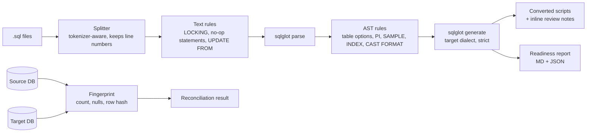

# sql-migration-accelerator

[](https://github.com/amritanshagrawal99/sql-migration-accelerator/actions/workflows/ci.yml)
[](LICENSE)

Convert legacy warehouse SQL to a cloud warehouse **and prove the migrated data matches**.

Source dialects with migration rules: **Teradata**, **Oracle** and **SQL Server (T-SQL)**. Targets: Snowflake, Databricks, BigQuery and anything sqlglot
generates.

Warehouse migrations (Teradata → Snowflake / Databricks) usually fail in two places: the long tail of dialect-specific SQL that
generic transpilers get subtly wrong, and the lack of a cheap, repeatable way to show the new tables hold the same data as the old
ones. This project tackles both:

| Stage | What it does |
|---|---|
| **`sma convert`** | Splits scripts into statements and converts each one, using [sqlglot](https://github.com/tobymao/sqlglot) plus a Teradata rule set that fixes constructs sqlglot alone leaves invalid. Each statement gets a status (`converted`, `converted_with_warnings`, `manual_review`, `dropped`), and every rewrite is logged with a rule code. |
| **Readiness report** | Markdown + JSON report: automation rate, statements that need attention, and how often each rule fired. Use `--strict` to fail CI when anything needs manual work. |
| **`sma reconcile`** | Compares a source table with its migrated copy using row counts, per-column null counts and an order-independent content hash. Values are normalised so engine type differences (`CHAR` padding, `DECIMAL` vs `DOUBLE`, column order) don't cause false mismatches. |

## Quickstart

```bash
pip install "sql-migration-accelerator[duckdb] @ git+https://github.com/amritanshagrawal99/sql-migration-accelerator.git"

sma convert examples/teradata -o converted --source teradata --target snowflake
sma reconcile --source-url duckdb:///legacy.db --source-table customer --target-url duckdb:///cloud.db
```

```
13 statements in 2 files -> converted
  converted               9
  converted_with_warnings 2
  manual_review           0
  dropped                 2
  automation rate         100%
```

## Example

Teradata input ([examples/teradata/customer_load.sql](examples/teradata/customer_load.sql)):

```sql
CREATE MULTISET VOLATILE TABLE vt_customer_delta, NO FALLBACK, NO LOG AS (
    SEL c.customer_id, ZEROIFNULL(c.credit_limit) AS credit_limit, ...
    QUALIFY ROW_NUMBER() OVER (PARTITION BY c.customer_id ORDER BY c.updated_ts DESC) = 1
) WITH DATA PRIMARY INDEX (customer_id) ON COMMIT PRESERVE ROWS;

COLLECT STATISTICS ON vt_customer_delta COLUMN (customer_id);

UPDATE tgt
FROM edw_core.dim_customer tgt, vt_customer_delta src
SET full_name = src.full_name
WHERE tgt.customer_id = src.customer_id;
```

Snowflake output:

```sql
CREATE TEMPORARY TABLE vt_customer_delta AS
(
  SELECT c.customer_id, ZEROIFNULL(c.credit_limit) AS credit_limit, ...
  QUALIFY ROW_NUMBER() OVER (PARTITION BY c.customer_id ORDER BY c.updated_ts DESC NULLS LAST) = 1
);

-- [dropped, line 15] COLLECT STATISTICS ON vt_customer_delta COLUMN (customer_id)

UPDATE edw_core.dim_customer AS tgt SET full_name = src.full_name
FROM vt_customer_delta AS src
WHERE tgt.customer_id = src.customer_id;
```

On its own, sqlglot rejects this `CREATE` (`Unsupported property volatileproperty`) and cannot parse the Teradata `UPDATE ... FROM ... SET` form.

## How it works



- **One bad statement never blocks a file.** Each statement is converted on its own, and failures are kept as commented source with a `TODO(sma)` marker.
- **Strict generation.** Output is generated with `unsupported_level=RAISE`. Anything the target can't express becomes `manual_review` instead of silently invalid SQL.
- **Reconciliation hash.** The hash is the sum of per-row SHA-256 prefixes mod 2^64. Unlike XOR, it is order-independent *and* catches duplicate rows. It works over any DB-API 2.0 connection (Snowflake, Databricks SQL, DuckDB, SQLite).

The full list of rules is in [docs/rules.md](docs/rules.md).

## Reconciling inside the database

```bash
sma reconcile --source-url duckdb:///legacy.db --source-table fact_sales --target-url duckdb:///cloud.db --pushdown
```

`--pushdown` (or `sma.pushdown.reconcile_pushdown()` with any DB-API connection) computes the fingerprint in each engine. It
generates one query per side, and only a single row of aggregates crosses the network. On 1M rows in DuckDB it takes 0.6 s,
against 15.7 s when streaming rows to Python.

The fingerprints are **comparable across engines**. Each engine renders values into the same canonical text: numbers as
`DECIMAL(38,6)` text, right-trimmed strings, ISO dates and microsecond timestamps, `N`/`V` null markers. The hash is the
first 15 hex digits of `MD5(row)`, summed. Templates exist for DuckDB, Snowflake, Databricks/Spark and Postgres.
[`reference_fingerprint`](src/sma/pushdown.py) is the Python specification. The DuckDB SQL is tested to match it exactly,
including duplicates, NULLs and type differences such as `INTEGER` vs `DECIMAL` and `CHAR` padding. The Snowflake,
Databricks and Postgres SQL is checked to parse in each dialect, but **has not yet been run against live warehouses**.

## Finding the rows that differ

When `reconcile` reports a mismatch, `diff` finds exactly which rows and columns differ:

```bash
sma diff --source-url duckdb:///legacy.db --source-table fact_sales --target-url duckdb:///cloud.db --key sale_id
```

```
DIFF   1000000 source rows vs 1000000 target rows; 3/256 buckets differ
       changed=3
  ~ (17)  amt: '4.25' -> '-1'
  ~ (500000)  amt: '125000' -> '-1'
  ~ (999999)  amt: '249999.75' -> '-1'
```

The diff makes two passes, so memory stays bounded:
1. Both sides are streamed once, and each row's hash is added to one of 256 buckets chosen by hashing its key.
2. Only rows in buckets whose fingerprints disagree are re-read and compared key by key.

The output reports missing rows, extra rows, duplicate keys and changed rows. Changed rows include column-level before and after
values, after normalisation, so type differences between engines don't show up as changes. Composite keys are supported:
`--key store_id,day`.

## Python API

```python
from sma import convert_statement, reconcile

res = convert_statement("SEL TOP 10 * FROM t SAMPLE 0.1", source="teradata", target="snowflake")
print(res.status, res.target_sql, [i.code for i in res.issues])

# Any DB-API 2.0 connections work, e.g. teradatasql + snowflake-connector-python
result = reconcile(src_conn, "edw.customer", tgt_conn, "EDW.CUSTOMER")
print(result.describe())
```

## Development

```bash
python -m venv .venv && . .venv/bin/activate
pip install -e ".[dev]"
pytest && ruff check src tests
```

## Roadmap

See the [issues](https://github.com/amritanshagrawal99/sql-migration-accelerator/issues). Highlights:
- Run the pushdown SQL against live Snowflake / Databricks in CI (needs credentials)
- Teradata macros and stored procedures → Snowflake Scripting
- Column-level diff to locate the exact mismatching rows
- More source dialects (Netezza, Redshift)

## Acknowledgements

Built on [sqlglot](https://github.com/tobymao/sqlglot) (MIT), which provides parsing and generation for 30+ dialects. Gaps found in sqlglot are reported and fixed upstream where possible.

## License

[MIT](LICENSE)
